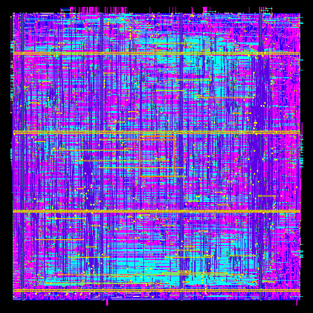
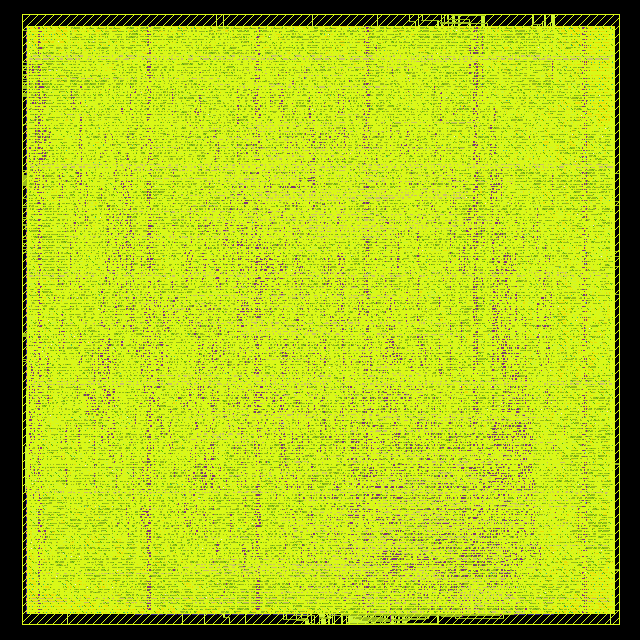
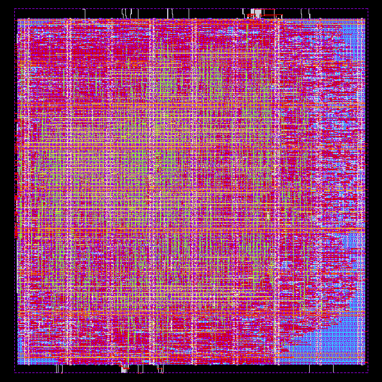
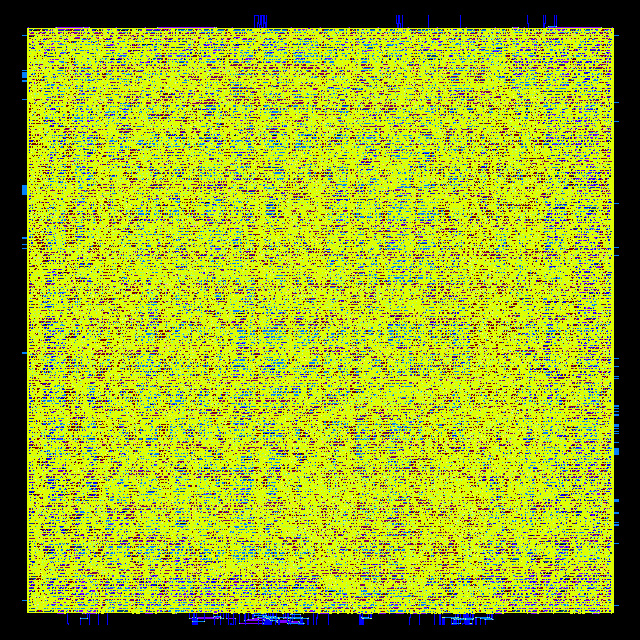
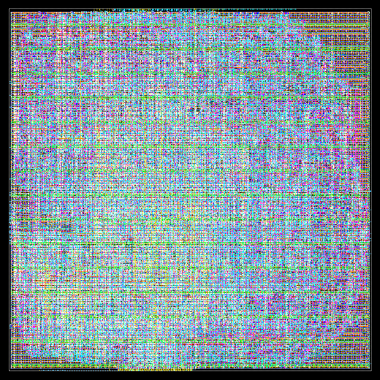
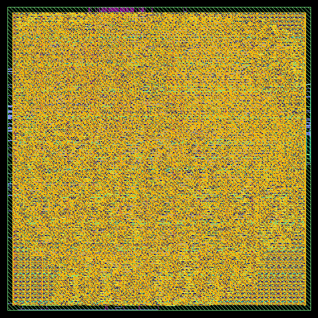
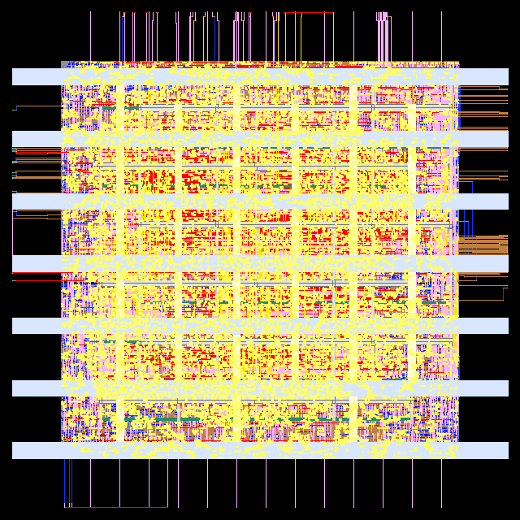
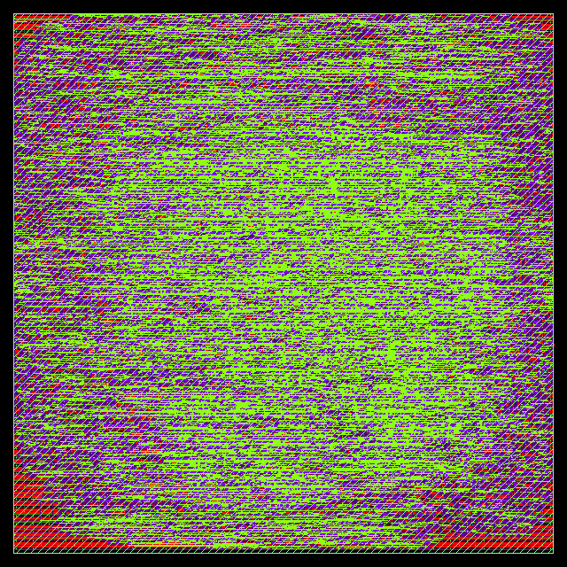

# PPA-optimized 32-bit pipelined ALU on every open PDK

The flagship example of this repository: a real, dual-mode 32-bit pipelined
ALU taken from RTL to GDSII on all open PDKs here, each run at its edge (the
shortest clock that closes timing) and compared with the original
Cadence/GPDK045 implementation.

The design is
[BekiryY/PPA-Optimized-32-bit-Pipelined-ALU-Design](https://github.com/BekiryY/PPA-Optimized-32-bit-Pipelined-ALU-Design)
(MIT, see [LICENSE](LICENSE)). The RTL in [`rtl/`](rtl) is a copy of upstream
commit `312caa8` with two small changes, marked `all_free_pdks:` in the source:

- `ALU_TOP.sv`: idle outputs drive `0` instead of `z`. Open standard cell
  libraries have no usable tristate drivers, and every consumer of these outputs
  is qualified by `output_valid` anyway.
- `SHIFTER.sv`: a default assignment so the shifter synthesizes without a latch.

## The design

Add, multiply, shift and logic operations with a 3-stage pipeline, conflict
handling and flags. It has two modes selected by the `low_power` input:

- **turbo:** fast adder and multiplier, full clock rate.
- **low power:** area- and power-lean adder and multiplier (`ADDER32_LP`,
  `MULT32_LP`), meant to run on a clock 9.22x slower (upstream: 1.66 GHz vs
  180 MHz).

## Run it

Inside LibreLane's nix-shell (or any shell with `librelane`, `openroad`,
`yosys` and `klayout` on `PATH`), from the repository root:

```bash
examples/PPA-opt-32b-alu-bekiryy/run.sh sky130A                  # RTL -> GDS
examples/PPA-opt-32b-alu-bekiryy/scripts/report_modes.sh sky130A  # turbo + low-power STA/power
```

PDKs: `sky130A gf180mcuD ihp-sg13g2 icsprout55` (LibreLane, config in
[`librelane/config.yaml`](librelane/config.yaml)) and `nangate45 asap7 gt2n osu025`
(ORFS, configs in [`orfs/`](orfs)). LibreLane runs land in
`librelane/runs/<pdk>/`, ORFS runs in `pdks/orfs/flow/results/<pdk>/alu/`, mode
reports in `work/alu-modes/<pdk>-<mode>.json`.

Runtime and peak memory on a 28-thread machine: 10–45 minutes and 4–12 GB per
PDK; gt2n needs more (see the table). Do not run more than two PDKs at once on
a 32 GB machine; detailed routing of several at the same time can run out of
memory.

## Constraints and the two modes

One SDC, [`constraints/alu.sdc`](constraints/alu.sdc), serves both modes. The
layout is built for turbo; low power is the same layout, analyzed again with
`ALU_MODE=lowpower`:

- `set_case_analysis` on `low_power` (0 for turbo, 1 for low power) tells STA
  which datapath is active, so turbo timing ignores the slow LP blocks and
  low-power timing uses them.
- The upstream SDC instead put a multicycle path through the LP block
  instances (`-through [get_cells adder_lp]`). Those hierarchical names do not
  survive the flattening that both flows do, so the exception silently matched
  nothing and the LP blocks showed up as turbo-mode failures.
- IO delays are 20% of the period on both sides; clock uncertainty is 2% of
  the turbo period in both modes.

[`scripts/report_modes.sh`](scripts/report_modes.sh) runs OpenSTA on the final
layout (signoff SPEF where the flow has one) once per mode and writes setup/hold
slack and power (10% input activity) to JSON.

## Results

Edge criterion: typical-corner setup slack between 0 and +3% of the period,
hold met, 0 routing DRC, core utilization of at least 50% (target 55%; 47%
on gt2n, see below).

| PDK | Node | Flow | Turbo clock | Setup slack | Turbo power | Turbo energy/op | Low-power clock | Low-power power | Low-power energy/op | Core area | Utilization | Route DRC |
| --- | --- | --- | ---: | ---: | ---: | ---: | ---: | ---: | ---: | ---: | ---: | ---: |
| osu025 | 0.25 µm | ORFS | 90.9 MHz | +40 ps (0.4%) | 329.6 mW* | 3,625 pJ | 9.9 MHz | 36.96 mW* | 3,748 pJ | 3,716,350 µm² | 57% | 0 |
| gf180mcuD | 180 nm | LibreLane | 54.1 MHz | +99 ps (0.5%) | 178.3 mW | 3,299 pJ | 5.9 MHz | 19.12 mW | 3,261 pJ | 685,054 µm² | 65% | 0 |
| sky130A | 130 nm | LibreLane | 113.6 MHz | +79 ps (0.9%) | 28.5 mW | 251 pJ | 12.3 MHz | 3.10 mW | 251 pJ | 308,336 µm² | 62% | 0 |
| ihp-sg13g2 | 130 nm SiGe | LibreLane | 151.5 MHz | +187 ps (2.8%) | 27.0 mW | 178 pJ | 16.4 MHz | 2.96 mW | 180 pJ | 395,162 µm² | 63% | 0 |
| icsprout55 | 55 nm | LibreLane | 333.3 MHz | +24 ps (0.8%) | 19.8 mW* | 59.5 pJ | 36.2 MHz | 2.15 mW* | 59.6 pJ | 67,236 µm² | 67% | 0 |
| nangate45 | 45 nm | ORFS | 806.5 MHz | +2 ps (0.2%) | 32.9 mW | 40.8 pJ | 87.5 MHz | 4.61 mW | 52.7 pJ | 48,569 µm² | 57% | 0 |
| asap7 | 7 nm | ORFS | 1.56 GHz | +1 ps (0.1%) | 12.3 mW | 7.88 pJ | 169.5 MHz | 1.33 mW | 7.88 pJ | 3,570 µm² | 57% | 0 |
| gt2n | 2 nm | ORFS | 1.33 GHz | +13 ps (1.7%) | 6.3 mW | 4.71 pJ | 144.6 MHz | 0.85 mW | 5.89 pJ | 1,662 µm² | 50% | 0 |
| GPDK045 (reference) | 45 nm | Genus/Innovus | 1.66 GHz | +21 ps (3.5%) | 51.9 mW | 31.3 pJ | 180 MHz | 3.30 mW | 18.3 pJ | ≈67,700 µm²† | 77% | – |

**gt2n is slower than asap7** on this design. Its low metal layers are very
resistive, so long or high-fanout nets cost far more delay than at 7 nm, and
the critical input-to-output path ends up at about 420 ps of a 750 ps clock.
It runs at 47% target utilization (50% measured) with the 100 ps slew limit
from this repo's gt2n settings, which also keep standard cells out of the rows
crossed by M2 power stripes (otherwise detailed routing leaves M1 end-of-line
violations there).

- Setup slack is the worst typical-corner slack at signoff (for LibreLane,
  over all RC corners), in turbo mode. Hold is met everywhere.
- Power is OpenSTA's estimate on the routed layout at 10% input activity;
  energy/op is power × clock period. \* icsprout55 and osu025 have no RC
  extraction rules, so their power uses placement-estimated wires.
- Utilization is logic cell area (without fill, tap and decap cells) over core area.
- **GPDK045** is the original implementation (Cadence Genus/Innovus, upstream
  README), using a fast-corner 1.2 V library, while the open PDKs are signed off
  at typical. Its low-power mode also runs at 1.0 V with UPF power gating of the
  turbo datapath. † Core area derived from its 52,380 µm² cell area at 77%
  utilization.

**Low power only saves power, not energy, in the open flows.** Energy per
operation is about the same in both modes: the slower clock divides power by
roughly 9, and nothing else changes, because both datapaths still switch
and the supply stays the same. GPDK045 gets its 40% lower energy/op from the
lower supply and power gating, which needs UPF support that these flows do not
have. Compare trends across nodes, not absolute numbers against GPDK045.

### Layouts

Not to scale: each image is fit to its own die.

| sky130A | gf180mcuD | ihp-sg13g2 | icsprout55 |
| :---: | :---: | :---: | :---: |
|  |  |  |  |
| **nangate45** | **asap7** | **gt2n** | **GPDK045 (original)** |
|  |  |  |  |
| **osu025** | | | |
|  | | | |

On osu025 every flip-flop is the library's `DFFSR` (its only flop with an
asynchronous reset), whose unused set pin is tied high: about 1,400 TIEHI cells
(see the [osu025 tie cells](../../overlays/osu025/make_tie_cells.py)).
