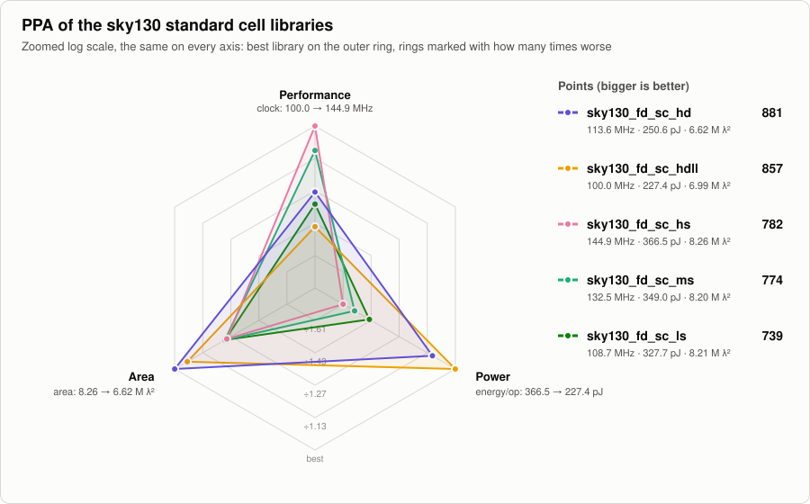

# The ALU on sky130's five cell libraries

The [32-bit ALU](../PPA-opt-32b-alu-bekiryy) taken from RTL to GDS with each
sky130 standard cell library, every library at its own edge clock, then scored
like the PDKs in [`pdk_scoring`](../../pdk_scoring).



## Run it

hd and hs come with the default install. ms, ls and hdll need the extra
libraries (about 10 GB more):

```bash
python3 install_pdks.py --only sky130 --extra-libs
```

Then, inside LibreLane's nix-shell, from the repository root:

```bash
examples/sky130_libraries/run.sh --threads 8
```

[`run.sh`](run.sh) runs the five libraries in parallel with
[`scripts/batch.py`](../../scripts/batch.py) (its options, such as `--threads`,
`--mem-per-job` and `--max-jobs`, pass through), then the power reports,
[`collect.py`](collect.py) → [`libraries.csv`](libraries.csv), and
`pdk_scoring/score.py --libraries` → [`ppa.svg`](ppa.svg). One library alone:
`examples/PPA-opt-32b-alu-bekiryy/run.sh sky130A/hdll`.

Each run takes 17–27 minutes at 8–12 threads (25–44 at 4) and peaks at 1.5–3.1 GB.
The clocks are the `scl::` blocks of the ALU's
[`librelane/config.yaml`](../PPA-opt-32b-alu-bekiryy/librelane/config.yaml).

## Results

| Library | Clock | Setup slack | Power | Energy/op | Logic area | Utilization | Leakage | Points |
| --- | ---: | ---: | ---: | ---: | ---: | ---: | ---: | ---: |
| hd | 113.6 MHz (8.8 ns) | +79 ps (0.9%) | 28.5 mW | 251 pJ | 191,387 µm² | 62% | 0.16 µW | 881 |
| hdll | 87.0 MHz (11.5 ns) | +161 ps (1.4%) | 19.8 mW | 228 pJ | 205,331 µm² | 60% | 0.13 µW | 813 |
| hs | 144.9 MHz (6.9 ns) | +50 ps (0.7%) | 53.1 mW | 366 pJ | 238,855 µm² | 62% | 2.41 µW | 782 |
| ms | 132.5 MHz (7.55 ns) | +54 ps (0.7%) | 46.2 mW | 349 pJ | 236,971 µm² | 62% | 0 µW‡ | 774 |
| ls | 108.7 MHz (9.2 ns) | +1 ps (0.0%) | 35.6 mW | 328 pJ | 237,165 µm² | 62% | 0.34 µW‡ | 739 |

Same edge rule as the ALU example: worst typical-corner setup slack between 0
and +3% of the period, hold met, 0 route DRC, at least 50% utilization. Every
run is also clean in Magic and KLayout DRC and LVS. Power is OpenSTA at 10%
input activity on the routed layout; logic area excludes fill, tap and decap
cells. Points are the [`pdk_scoring`](../../pdk_scoring) formulas: speed = 10 ×
MHz, energy = 100,000 / pJ per operation, density = 10,000 / logic area in Mλ²
(λ = 0.17 µm for every library, the same metal stack), overall = geometric mean.
The chart zooms in with one log scale shared by all three axes: the best
library of each axis on the outer ring, each ring further in a fixed factor
worse, so equal ratios look equal on every axis.

- **hd wins overall:** the smallest logic and the second-lowest energy.
- **hs is the fastest**, 28% above hd, for 46% more energy per operation and
  25% more area. ms sits between hs and ls in speed and energy.
- **hdll has the lowest energy per operation**, 9% below hd, and 20% less
  leakage than hd, but the slowest clock (23% below hd) and 7% more area. This
  is after [two fixes to its data](#hdll-liberty-area-bug); before them, hdll
  was last by far.
- **ls wins no axis** on this design.
- **The critical path is combinational, input to output** (A[31] → Y[18] on hs).
  With 20% input and 20% output delay and 2% uncertainty it gets only 58% of the
  period, so each ns of clock buys only about 0.58 ns of slack. The libraries'
  ranking holds for a registered design, but their absolute clocks would be shorter.
- **ms and ls leakage is incomplete.** Every `cell_leakage_power` in
  sky130_fd_sc_ms is 0 (‡ in the table). In sky130_fd_sc_ls only the
  flip-flops, latches and `inv_1` have a value (69 of 386 cells; 14,666 of the
  ALU's 16,102 logic cells read 0), so ls's 0.34 µW is its flip-flops alone.
  Neither is comparable, and leakage is not scored. Dynamic power is unaffected.
- **No library uses isolation or other power-management cells.** hd excludes
  its 34, hs, ms and ls have none, and hdll's are excluded by the fix below, so
  every layout is built from ordinary logic cells and flip-flops.

## hdll Liberty area bug

In sky130_fd_sc_hdll, 16 high-drive cells have a Liberty `area` 2.4× to 11.3×
below their real size (the LEF `SIZE`). `nand2_12` claims 3.75 µm² against
32.53 µm², less than `nand2_1`. Eight more differ by less than 10%. hd, hs, ms
and ls have no such mismatch. The values come from upstream
[skywater-pdk-libs-sky130_fd_sc_hdll](https://github.com/google/skywater-pdk-libs-sky130_fd_sc_hdll)
and open_pdks passes them through. Reported upstream as
[google/skywater-pdk#452](https://github.com/google/skywater-pdk/issues/452).

Synthesis minimizes area, so it took these cells as nearly free: 6,407
`nand2_12` in the ALU.

### Isolation cells

With the areas fixed, synthesis switched to 2,528 `isobufsrc_1`. It is a
power-gating isolation cell, but it computes A·!SLEEP, the function of
`and2b_1`, in 2.30 µm width against 3.22 µm. hd excludes its isolation cells
through LibreLane's `drc_exclude.cells`; hdll's list names them with hd's
`lpflow_` prefix, which hdll's cells do not have, so 7 of them slipped
through. `isobufsrc_1` leaks 1.24 nW in one input state against about
0.001 nW in the other three, which made the isolation cells 88% of that
layout's leakage.

| hdll | As shipped | Liberty area fixed | Isolation cells also excluded |
| --- | ---: | ---: | ---: |
| Clock | 11.2 ns | 10.0 ns | 11.5 ns |
| Energy/op | 385 pJ | 227 pJ | 228 pJ |
| Logic area | 428,623 µm² (14.83 M λ²) | 201,919 µm² (6.99 M λ²) | 205,331 µm² (7.10 M λ²) |
| Leakage | 0.35 µW | 0.74 µW | 0.13 µW |
| Points (rank) | 539 (5th) | 857 (2nd) | 813 (2nd) |

The final clock is 3% slower than as shipped, probably because the misused
cells were large high-drive cells: fast as well as falsely cheap.

### Fix in this repo

Two per-PDK rules in [`pdks.json`](../../pdks.json), applied by
`install_pdks.py`:

- `liberty_area_from_lef` sets every Liberty `area` to the cell's LEF size
  when they differ by more than 1%, for the library directories it globs
  (`sky130*/libs.ref/sky130_fd_sc_hdll`).
- `exclude_cells` adds the real names of the 7 missed cells
  (`isobufsrc_1/2/4/8/16`, `inputiso0p_1`, `inputiso1n_1`) to hdll's
  `drc_exclude.cells`.

Both work for any library with the same kind of problem. They run at install,
so an existing install needs `python3 install_pdks.py --only sky130 --extra-libs`
again.
