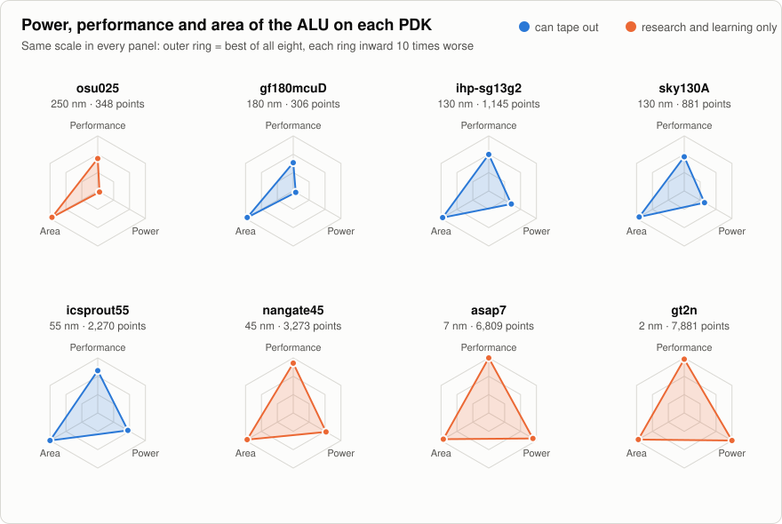
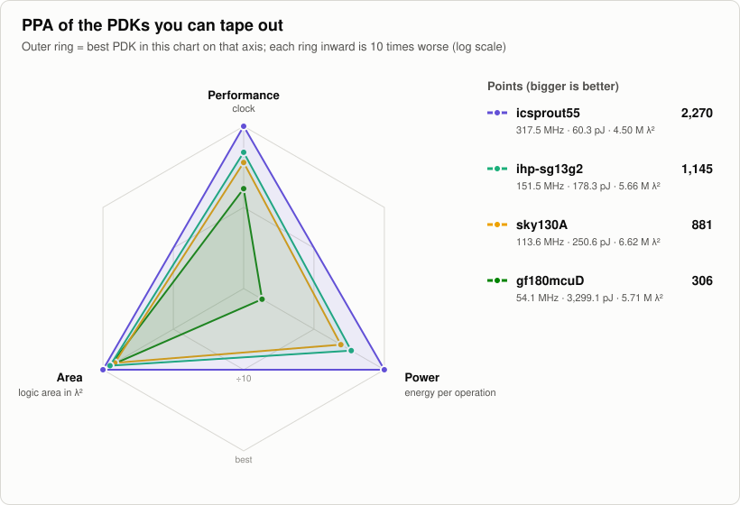
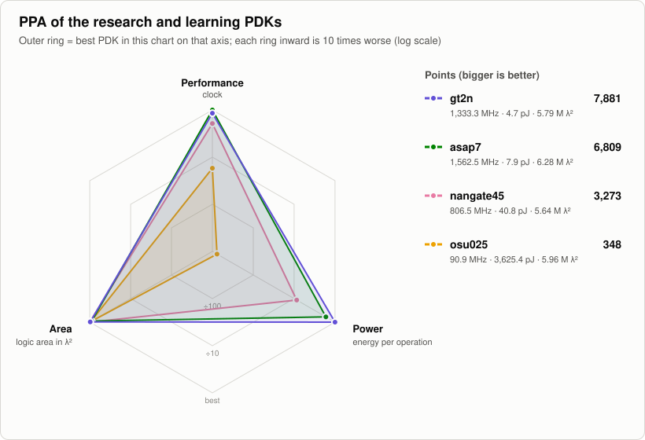
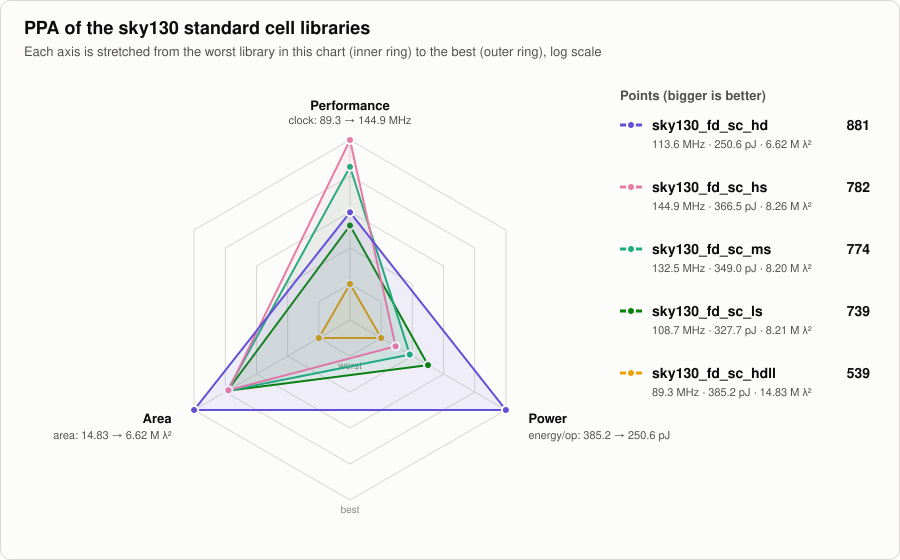

# PDK scoring

One set of points per PDK, so the eight PDKs in this repository can be
compared at a glance. The points come from one real design, the 32-bit
pipelined ALU in [`examples/PPA-opt-32b-alu-bekiryy`](../examples/PPA-opt-32b-alu-bekiryy),
taken from RTL to GDS on every PDK at the fastest clock it closes timing at.



| File | What it is |
| --- | --- |
| [`inputs.csv`](inputs.csv) | the measured inputs, one row per PDK |
| [`sky130_libraries.csv`](sky130_libraries.csv) | the same inputs for the sky130 library comparison, one row per library |
| [`score.py`](score.py) | computes the points and draws the charts (`python3 pdk_scoring/score.py`, standard library only) |
| `ppa_*.svg` | the charts on this page |

## Points

| # | PDK | Clock | Speed | Energy/op | Energy | Logic area | Density | Overall |
| ---: | --- | ---: | ---: | ---: | ---: | ---: | ---: | ---: |
| 1 | gt2n | 1,333.3 MHz | 13,333 | 4.71 pJ | **21,238** | 5.79 M λ² | 1,728 | **7,881** |
| 2 | asap7 | 1,562.5 MHz | **15,625** | 7.88 pJ | 12,688 | 6.28 M λ² | 1,593 | 6,809 |
| 3 | nangate45 | 806.5 MHz | 8,065 | 40.81 pJ | 2,451 | 5.64 M λ² | 1,774 | 3,273 |
| 4 | icsprout55 | 317.5 MHz | 3,175 | 60.35 pJ | 1,657 | 4.50 M λ² | **2,224** | 2,270 |
| 5 | ihp-sg13g2 | 151.5 MHz | 1,515 | 178.31 pJ | 561 | 5.66 M λ² | 1,766 | 1,145 |
| 6 | sky130A | 113.6 MHz | 1,136 | 250.56 pJ | 399 | 6.62 M λ² | 1,510 | 881 |
| 7 | osu025 | 90.9 MHz | 909 | 3,625.39 pJ | 28 | 5.96 M λ² | 1,677 | 348 |
| 8 | gf180mcuD | 54.1 MHz | 541 | 3,299.10 pJ | 30 | 5.71 M λ² | 1,751 | 306 |

Bigger is better in every points column; the best in each is in **bold**.

- **gt2n scores highest overall**, ahead of asap7 on energy and density.
- **icsprout55 is the best PDK you can tape out** (2,270, twice ihp-sg13g2) and
  the best of all eight on density.
- **Density is close everywhere.** Once area is scaled to the node, all eight
  libraries are within 1.5× of each other. Speed (29× apart) and energy (770×)
  are where the nodes really differ.

## How the points are calculated

All inputs are from the ALU's turbo mode (the fastest clock), at the typical
corner.

| Metric | Input | Formula | Example |
| --- | --- | --- | --- |
| Speed | clock frequency f | 10 × f (MHz) | osu025: 90.9 MHz → 909 |
| Energy | energy per operation E = total power × clock period | 100,000 / E (pJ) | gt2n: 4.71 pJ → 21,238 |
| Density | logic cell area A in λ² (λ below) | 10,000 / A (M λ²) | icsprout55: 4.50 M λ² → 2,224 |
| **Overall** | the three points above | ∛(Speed × Energy × Density) | gt2n: ∛(13,333 × 21,238 × 1,728) = 7,881 |

The ALU finishes one operation per clock cycle, so power × period is the
energy of one operation.

### λ

λ is half the tightest routing pitch of the first two metal layers, read from
each PDK's tech LEF.

| PDK | Node name | Tightest pitch | λ | Logic area | Logic area in λ² |
| --- | ---: | ---: | ---: | ---: | ---: |
| osu025 | 250 nm | 1.2 µm (metal2) | 600 nm | 2,146,106 µm² | 5.96 M |
| gf180mcuD | 180 nm | 0.56 µm (Metal1) | 280 nm | 447,661 µm² | 5.71 M |
| ihp-sg13g2 | 130 nm | 0.42 µm (Metal1) | 210 nm | 249,706 µm² | 5.66 M |
| sky130A | 130 nm | 0.34 µm (li1, met1) | 170 nm | 191,387 µm² | 6.62 M |
| icsprout55 | 55 nm | 0.20 µm (MET1) | 100 nm | 44,962 µm² | 4.50 M |
| nangate45 | 45 nm | 0.14 µm (metal1) | 70 nm | 27,616 µm² | 5.64 M |
| asap7 | 7 nm | 36 nm (M1) | 18 nm | 2,035 µm² | 6.28 M |
| gt2n | 2 nm | 24 nm (M0) | 12 nm | 833 µm² | 5.79 M |

Example: icsprout55, 44,962 µm² / (0.1 µm)² = 4.50 M λ².

### Why these choices

- **Area is scaled, power is not.**
  - In absolute terms, gt2n's ALU is 2,600 times smaller than osu025's, so a
    raw-area score would only measure how small the node is.
  - Silicon is also far cheaper per mm² at old nodes, so a big layout there
    does not cost what it would at 7 nm.
  - Dividing by λ² measures how well the cell library and the flow use the
    node they have.
  - A joule, in contrast, drains the same battery and makes the same heat at
    any node, so energy stays absolute.
- **λ from the metal pitch, not the node name.**
  - Below about 20 nm a node name is a product label, not a size.
  - Taking λ = 1 nm for "2 nm" would put gt2n's ALU at 208 M (node)², 18 times
    worse than sky130A: the opposite distortion of absolute area.
  - The routing pitch is a real, comparable dimension in every PDK.
- **Energy per operation, not power.** Power at each PDK's own clock rewards
  running slowly. Energy per operation takes the clock out.
- **Logic area, not core area.** Core area includes the utilization picked for
  each run (50% to 65% here). Logic area is the cells alone.
- **Geometric mean for the overall score.**
  - A 2× lead counts the same in every metric.
  - Energy, which spans 770×, cannot drown out density, which spans 1.5×.
  - With a plain sum, density would barely move the total.
- **The constants are only a scale.** 10, 100,000 and 10,000 put a mid-range
  PDK near 1,000 points per metric. Changing one multiplies every PDK's overall
  score by the same factor, so the ranking never changes.
- **GPDK045 is left out.** Its ALU results come from Cadence Genus and Innovus
  on the 1.2 V fast-corner library, so its points would not mean the same
  thing. It is still shown as a reference in the
  [ALU comparison](../examples/PPA-opt-32b-alu-bekiryy/alu_pdk_performances.md).

### Shown but not scored

| PDK | Supply | Leakage | Can tape out |
| --- | ---: | ---: | --- |
| osu025 | 2.5 V | 2.92 µW | no (legacy MOSIS process) |
| gf180mcuD | 5.0 V | 4.22 µW | yes |
| ihp-sg13g2 | 1.2 V | 10.58 µW | yes |
| sky130A | 1.8 V | 0.16 µW | yes |
| icsprout55 | 1.2 V | 3.10 µW | yes (test and academic shuttles) |
| nangate45 | 1.1 V | 507.0 µW | no (predictive) |
| asap7 | 0.7 V | 1.22 µW | no (predictive) |
| gt2n | 0.7 V | 181.5 µW | no (predictive) |

- **Supply voltage** is already inside the energy score. Switching energy grows
  with the square of the voltage, and gf180mcuD's library runs at 5 V.
- **Leakage** depends mostly on which threshold voltages the flow picks (gt2n
  mixes SVT and LVT cells), not on the PDK alone.
- **Tape-out** is a yes-or-no fact, not a number; see
  [Manufacturability](../README.md#manufacturability).

## The PPA hexagons

Each chart has three axes on alternate corners of a hexagon: **Performance**
(speed points), **Power** (energy points) and **Area** (density points). On
every axis, further out is better.

- **Each PDK** (top of this page): true ratios on one scale shared by all
  eight panels, so panels can be compared directly. A PDK's point on an axis is
  its points divided by the best of all eight, on a log scale. The outer ring
  is the best, and each ring inward is 10 times worse; a log scale keeps PDKs
  770 times apart on the same chart. A bigger triangle means a higher overall
  score, but its area is not proportional to it.
- **By group** (below): each axis is stretched so the worst PDK in the group
  sits on the inner ring and the best on the outer ring, still on a log scale.
  This magnifies small gaps on purpose: on the research chart's area axis,
  the whole radius covers only 1.1×. The real range of each axis is printed
  under its name.
  The rings show position, not ratios, and the two group charts cannot be
  compared with each other.





osu025 is in the research-and-learning chart because it cannot be
manufactured any more: it is a legacy MOSIS process, not a predictive one.

## sky130 standard cell libraries

The same ALU on five of sky130's cell libraries, each at its own edge clock
(inputs in [`sky130_libraries.csv`](sky130_libraries.csv)). Same PDK, same
metal stack and the same λ (170 nm), so this compares the libraries alone.



| # | Library | Clock | Speed | Energy/op | Energy | Logic area | Density | Overall |
| ---: | --- | ---: | ---: | ---: | ---: | ---: | ---: | ---: |
| 1 | sky130_fd_sc_hd | 113.6 MHz | 1,136 | 250.56 pJ | **399** | 6.62 M λ² | **1,510** | **881** |
| 2 | sky130_fd_sc_hs | 144.9 MHz | **1,449** | 366.48 pJ | 273 | 8.26 M λ² | 1,210 | 782 |
| 3 | sky130_fd_sc_ms | 132.5 MHz | 1,325 | 348.98 pJ | 287 | 8.20 M λ² | 1,220 | 774 |
| 4 | sky130_fd_sc_ls | 108.7 MHz | 1,087 | 327.71 pJ | 305 | 8.21 M λ² | 1,219 | 739 |
| 5 | sky130_fd_sc_hdll | 89.3 MHz | 893 | 385.20 pJ | 260 | 14.83 M λ² | 674 | 539 |

- **hd, the default, scores highest overall.** It has the lowest energy and the
  smallest layout.
- **hs is the fastest**, 28% above hd, at 46% more energy per operation.
- **hs, ms and ls are one family.** Their layouts are the same size, and they
  trade speed for energy in order: hs fastest, ls most frugal.
- **hdll comes last on this design.** Its ALU needs 2.2 times hd's cell area
  and runs at the slowest clock.
- **Setup slack** at the worst typical corner: hd +79 ps, hs +50 ps,
  ms +54 ps, ls +1 ps and hdll +147 ps.
- **Signoff:** all five route with 0 DRC and are clean in Magic DRC, KLayout
  DRC and LVS.
- **Critical path.** On hs it is a combinational path from an input to an
  output, which the constraints give only 58% of the clock. That limits how
  far a faster library can push the clock on this design, so the speed gaps
  between libraries are smaller than in a fully registered circuit.
- **Leakage** is not compared: sky130's ms Liberty files give every cell zero
  leakage.

Reproduce with the extra libraries installed (`install_pdks.py --only sky130
--extra-libs`):

```bash
scripts/batch.py examples/PPA-opt-32b-alu-bekiryy/run.sh ::: \
    sky130A/hd sky130A/hs sky130A/ms sky130A/ls sky130A/hdll
```

On a 28-core machine with 24 GB, all five run at once. Each takes 20 to 45
minutes and peaks at about 2 GB.

## Where the inputs come from

| Column | Source |
| --- | --- |
| `clock_ns` | the turbo clock in the ALU's [config](../examples/PPA-opt-32b-alu-bekiryy) |
| `power_mw`, `leakage_uw` | [`report_modes.sh`](../examples/PPA-opt-32b-alu-bekiryy/scripts/report_modes.sh) turbo mode: OpenSTA on the routed layout, 10% input activity, extracted parasitics (estimated wires on icsprout55 and osu025, which have no RC extraction rules) |
| `logic_um2` | standard-cell area from the final layout, without fill, tap or decap cells |
| `pitch_um`, `pitch_layer` | the PDK's tech LEF (`PITCH` of the first two metal layers; the smaller one) |
| `vdd_v` | `nom_voltage` of the Liberty file the flow uses |

After rerunning the ALU, update `inputs.csv` and run `python3 pdk_scoring/score.py`.
It prints the points table above and redraws the charts.

## Limits

- **One design.** A 32-bit ALU is mostly datapath logic. Memories, analog
  blocks or I/O would score the PDKs differently.
- **Two flows.** LibreLane runs sky130A, gf180mcuD, ihp-sg13g2 and
  icsprout55; OpenROAD-flow-scripts runs the rest. Both drive the same
  OpenROAD, but the settings differ.
- **Typical corner only.** Real signoff needs slow and fast corners too.
- **λ is a proxy.** The metal pitch tracks layout density well, but cell
  height in tracks and transistor geometry also matter, so a library can beat
  its λ.
